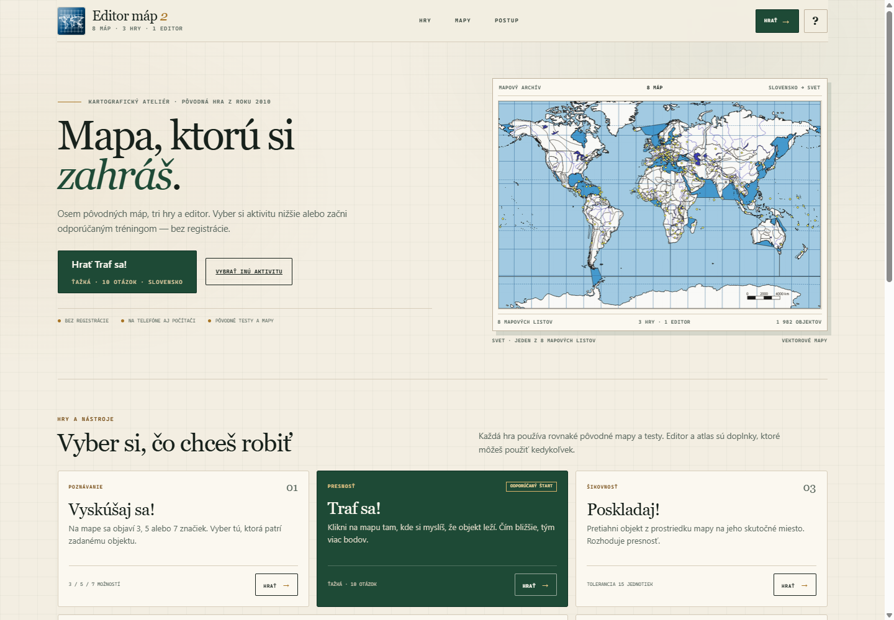
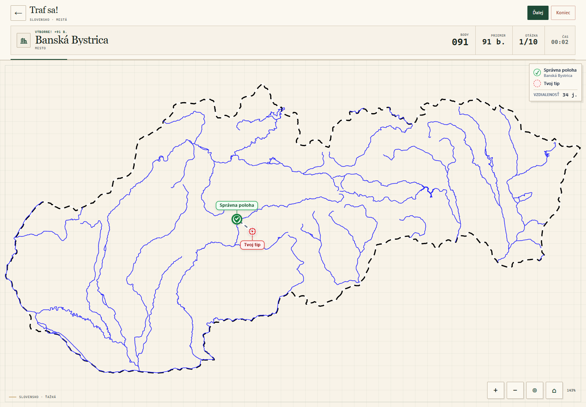
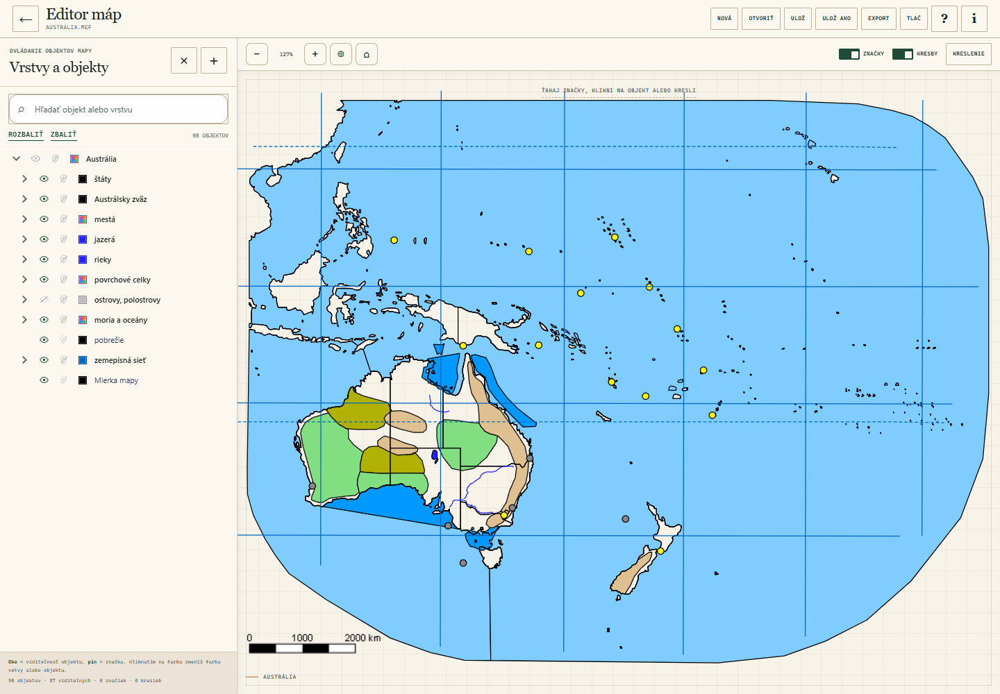
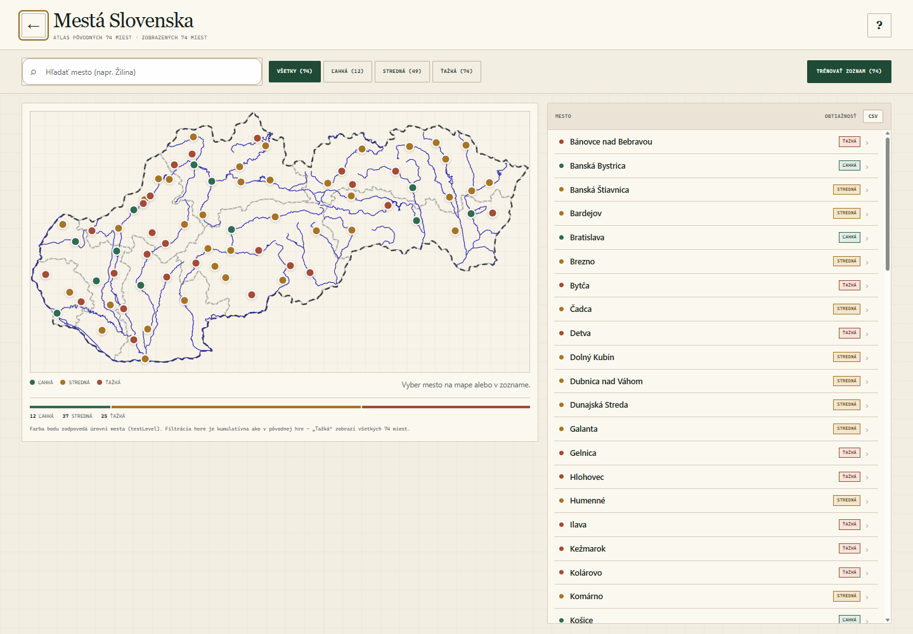
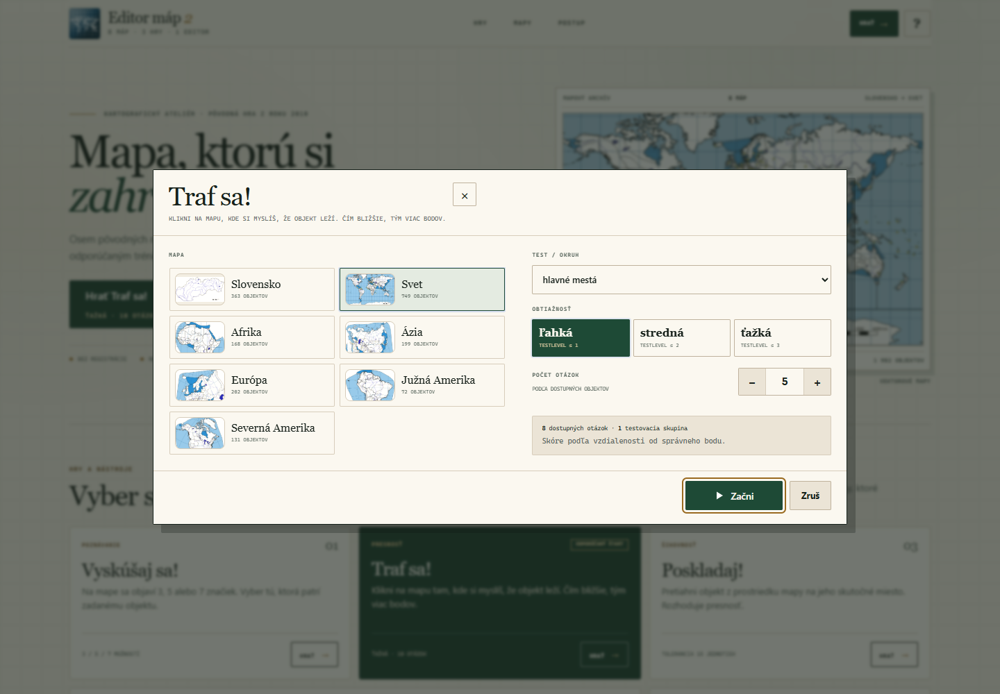
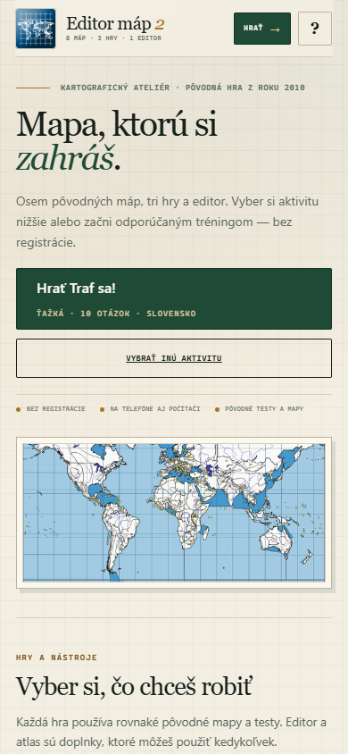
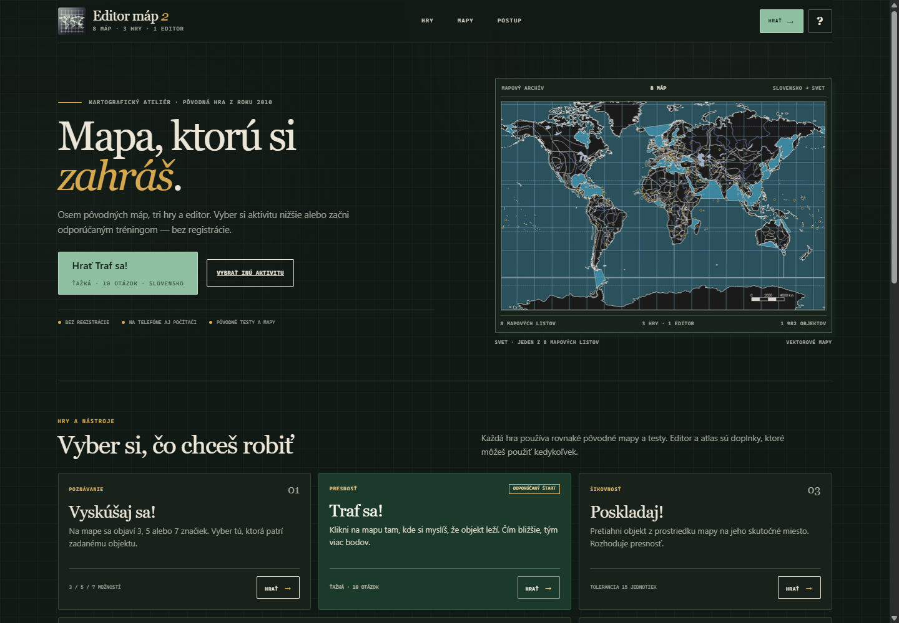
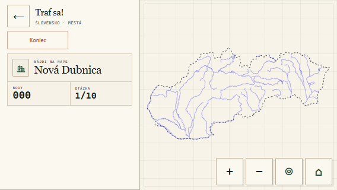

# Editor máp 2 — web version

### ▶ Play it now: **https://em.adriansliacky.sk/**

A free browser game for learning the map of Slovakia and the world, built around the original Slovak school game **Editor máp 2** (2010). It works on a phone, tablet or computer. There is nothing to install and no account to create.

---

## English

### What is it?

**Editor máp 2** is a small geography arcade. You can play three map games, browse an atlas of 74 Slovak cities, or open a full map editor and change the original maps yourself.

The project recreates the original game’s eight maps and 1,982 objects: Slovakia, Europe, the world, Africa, Asia, Australia, North America and South America. The original tests, difficulty levels and scoring rules are preserved. The interface and the map editor are a modern web rebuild.

### How to play

1. Open **https://em.adriansliacky.sk/**.
2. Choose an activity:
   - **Vyskúšaj sa!** — a place name is shown and several pins appear. Pick the correct pin.
   - **Traf sa!** — click where you think the place is. The closer you are, the more points you get.
   - **Poskladaj!** — drag the object from the middle of the map to its real location.
3. On a phone, pinch to zoom, drag with one finger to move the map after zooming, and use **◎** to return to the full map. **⌂** also shows the whole map.
4. No registration, download, or payment is required.

The green button on the homepage starts a recommended game immediately: **Traf sa! — hard — 10 questions — Slovakia**.

### Features

- **Three complete games** with the original maps, tests, difficulty levels and scoring.
- **Eight original maps** and 1,982 geographic objects.
- **Map editor** with layers, colours, custom labels, freehand and shape drawing, `.mef` save/open, PNG/JPEG export and printing.
- **City atlas** of all 74 Slovak cities with search, filters, statistics and quick training.
- **Bilingual interface**: Slovak and English, automatic browser-language detection on the first visit and a language selector in Settings.
- **Subtle sound cues** for answers and results, with a speaker button, a Settings switch and the `M` shortcut to mute them.
- **Mobile-first controls**: pinch zoom, one-finger pan after zooming, double-tap zoom, inertia, a dedicated recenter button and a locked full-map view.
- **Portrait and landscape layouts**: in landscape the game controls move to a compact side rail (156–196 px) and the map gets the full height.
- **Light and dark themes**, keyboard shortcuts, an accessible focus order and fast motion that respects reduced-motion settings.
- **Static site** — no backend, database, tracking or build server.

### Screenshots

| Homepage | A game |
| --- | --- |
|  |  |

| Map editor | City atlas |
| --- | --- |
|  |  |

| Activity setup | Mobile |
| --- | --- |
|  |  |

| Dark theme | Landscape game |
| --- | --- |
|  |  |

### Technical information

- Pure HTML, CSS and JavaScript; no framework and no build step.
- The site is deployed from the `webapp/` folder with GitHub Actions to GitHub Pages.
- Node.js 18+ is only needed for local development.
- Full technical documentation: [`webapp/README.md`](webapp/README.md) (English).
- Development and preview workflow: [`DEVELOPMENT.md`](DEVELOPMENT.md).
- Deployment guide: [`DEPLOYMENT.md`](DEPLOYMENT.md) (English).
- Custom domain guide: [`CUSTOM_DOMAIN.md`](CUSTOM_DOMAIN.md) (English).

### Credits

Original game: **RNDr. Štefan Karolčík, PhD** (author), **Ing. Juraj Hrabovec — MAX MEDIA** (design and programming), **RNDr. Daniel Gurňák, PhD** (map data), © 2010. This is a non-commercial educational reimplementation. The original names and map data remain the property of their authors.

Web reimplementation, design and development: **Adrian Sliacky**. Source code: [github.com/adrian-sliacky-gymzv/editor-map-2-web](https://github.com/adrian-sliacky-gymzv/editor-map-2-web).

---

# Slovenčina

### ▶ Zahraj si teraz: **https://em.adriansliacky.sk/**

Bezplatná webová hra na učenie sa mapy Slovenska a sveta, postavená na pôvodnej slovenskej školskej hre **Editor máp 2** (2010). Funguje na telefóne, tablete aj počítači. Netreba nič inštalovať ani si vytvárať účet.

### Čo to je?

**Editor máp 2** je malá geografická arkáda. Môžeš hrať tri mapové hry, prezerať atlas 74 slovenských miest alebo si otvoriť plnohodnotný editor a upraviť pôvodné mapy podľa seba.

Projekt obsahuje všetkých osem pôvodných máp a 1 982 objektov: Slovensko, Európu, svet, Afriku, Áziu, Austráliu, Severnú a Južnú Ameriku. Pôvodné testy, obtiažnosti a bodovanie zostali zachované. Rozhranie a editor sú modernou webovou reimplementáciou.

### Ako hrať

1. Otvor **https://em.adriansliacky.sk/**.
2. Vyber aktivitu:
   - **Vyskúšaj sa!** — zobrazí sa názov miesta a niekoľko značiek. Vyber tú správnu.
   - **Traf sa!** — klikni tam, kde si myslíš, že miesto leží. Čím bližšie, tým viac bodov.
   - **Poskladaj!** — pretiahni objekt zo stredu mapy na jeho skutočné miesto.
3. Na telefóne priblížiš mapu štipcom, po priblížení ju posúvaš jedným prstom a tlačidlom **◎** sa vrátiš na celú mapu. **⌂** tiež zobrazí celú mapu.
4. Bez registrácie, inštalácie alebo platby.

Zelené tlačidlo na domovskej stránke hneď spustí odporúčanú hru: **Traf sa! — ťažká — 10 otázok — Slovensko**.

### Funkcie

- **Tri kompletné hry** s pôvodnými mapami, testami, obtiažnosťami a bodovaním.
- **Osem pôvodných máp** a 1 982 geografických objektov.
- **Editor máp** s vrstvami, farbami, vlastnými popiskami, kreslením, ukladaním `.mef`, exportom PNG/JPEG a tlačou.
- **Atlas 74 slovenských miest** s hľadaním, filtrami, štatistikami a rýchlym tréningom.
- **Dvojjazyčné rozhranie**: slovenčina a angličtina, automatické rozpoznanie jazyka prehliadača pri prvej návšteve a výber jazyka v nastaveniach.
- **Jemné zvukové signály** pri odpovediach a výsledkoch, s tlačidlami reproduktora, prepínačom v nastaveniach a skratkou `M` na stlmenie.
- **Ovládanie na mobil**: pinch zoom, posun po priblížení, dvojité ťuknutie, zotrvačnosť, tlačidlo na vycentrovanie a pevná mapa pri predvolenom oddialení.
- **Portrait aj landscape**: v landscape sa ovládanie presunie do kompaktného bočného panelu (156–196 px) a mapa dostane celú výšku.
- **Svetlá a tmavá téma**, klávesové skratky, prístupný fokus a rýchle animácie s rešpektovaním nastavenia zníženého pohybu.
- **Statická stránka** — bez servera, databázy, sledovania a bez build kroku.

### Obrázky

Rovnaká galéria ako v anglickej časti je v priečinku [`screenshots/`](screenshots/).

### Technické informácie

- Čisté HTML, CSS a JavaScript; bez frameworku a bez build kroku.
- Nasadenie z priečinka `webapp/` cez GitHub Actions na GitHub Pages.
- Node.js 18+ je potrebný len na lokálny vývoj.
- Technická dokumentácia: [`webapp/README.md`](webapp/README.md) (anglicky).
- Vývoj a lokálny náhľad: [`DEVELOPMENT.md`](DEVELOPMENT.md).
- Návod na nasadenie: [`DEPLOYMENT.md`](DEPLOYMENT.md) (anglicky).
- Vlastná doména: [`CUSTOM_DOMAIN.md`](CUSTOM_DOMAIN.md) (anglicky).

### Autori

Pôvodná hra: **RNDr. Štefan Karolčík, PhD** (autor), **Ing. Juraj Hrabovec — MAX MEDIA** (dizajn a programovanie), **RNDr. Daniel Gurňák, PhD** (mapové podklady), © 2010. Ide o nekomerčnú edukačnú reimplementáciu. Pôvodné názvy a mapové podklady patria ich autorom.

Webová reimplementácia, dizajn a vývoj: **Adrian Sliacky**. Zdrojový kód: [github.com/adrian-sliacky-gymzv/editor-map-2-web](https://github.com/adrian-sliacky-gymzv/editor-map-2-web).
