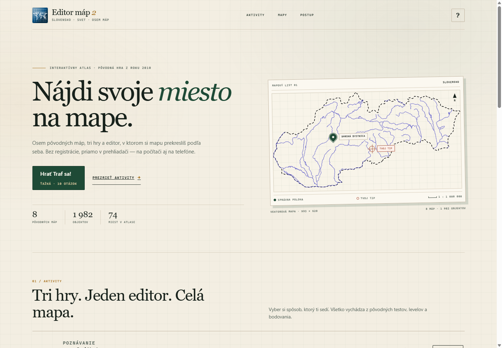
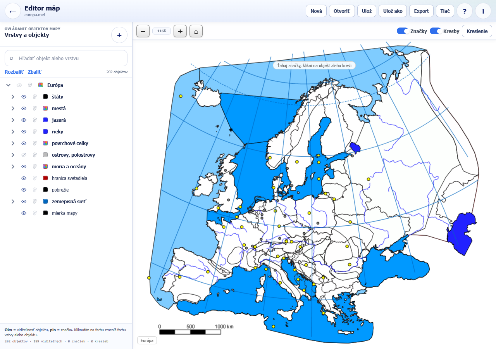
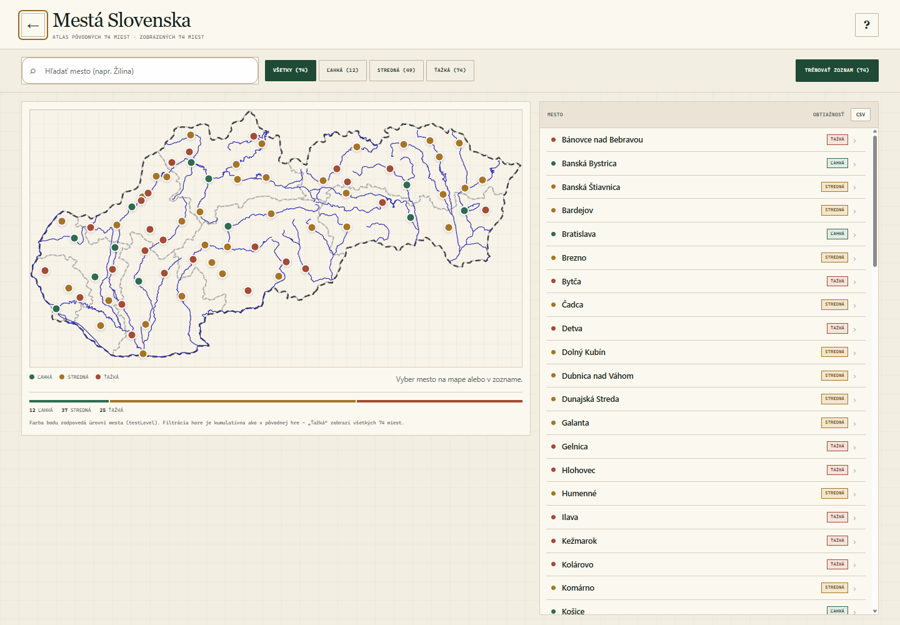
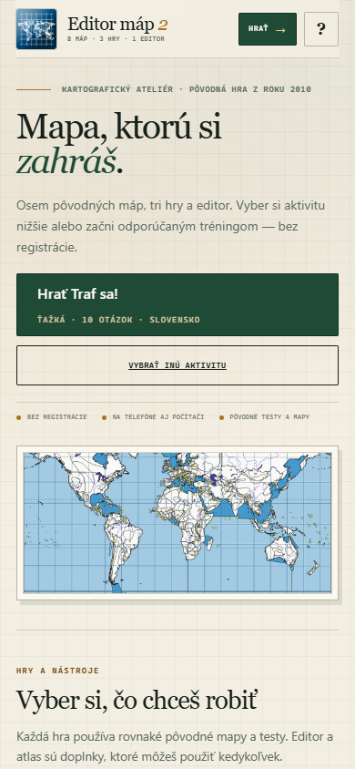

# Editor máp 2 — kompletná webová verzia

Nekomerčná, mobilná webová reimplementácia pôvodnej aplikácie **Editor máp 2**
(2010). Neobsahuje len Slovensko: obsahuje **všetkých 8 pôvodných máp**, všetky
testy a obtiažnosti z `config.xml`, obe pôvodné databázy `.mef`, všetkých
**1 982 geografických objektov** a **plnohodnotný editor máp** s vrstvami,
farbami, značkami, kreslením, ukladaním, exportom a tlačou.

Ako bonus zostal zachovaný aj moderný **atlas 74 slovenských miest** s hľadaním,
filtrami, štatistikami a rýchlym tréningom.

Domovská stránka štartuje hrdinovým tlačidlom **Traf sa! — ťažká obtiažnosť,
10 otázok, Slovensko**; ostatné aktivity si nastavíš v ich vlastných dialógoch.









## Vizuálny systém

Rozhranie je postavené ako **kartografický redakčný ateliér**, nie ako generická
karta s gradientom:

- teplý papier, tmavozelený atrament a okrové akcenty namiesto modrofialových
  gradientov a farebných pruhov na kartách,
- nadpisy v serifovom písme (Georgia / Palatino), technické štítky a čísla
  v monospace písme,
- jemné pravidlá, prehľadné karty aktivít, rámované mapové listy a súradnicové
  popisky namiesto jednotnej mriežky zaoblených boxov,
- mapové plátno je položené na milimetrovom papieri, takže prázdny priestor
  okolo mapy pôsobí ako pracovná plocha, nie ako chýbajúci obsah,
- horná lišta s navigáciou a rýchlym **Hrať** tlačidlom zostáva pri scrollovaní
  poruke; domov je prehľadnejší a kratší,
- hero používa všeobecnú svetovú mapu, nie jednu konkrétnu krajinu,
- klikateľný výber mapy otvorí **Vyskúšaj sa!** pre zvolenú mapu,
- tmavá téma je samostatná kurátorovaná paleta, nie automatické prevrátenie
  stránky.

## Čo je súčasťou

### Pôvodné aktivity

- **Vyskúšaj sa!** — všetkých 8 máp a všetky testy z `config.xml`.
  Na mape sa zobrazí 3, 5 alebo 7 kandidátov; jeden patrí zadanému objektu.
  Otázky sa ťahajú z pôvodných testovacích skupín a filtrujú sa podľa
  `testLevel`. Bodovanie je podiel správnych odpovedí.
- **Traf sa!** — 7 pôvodných máp (config pre túto aktivitu neobsahuje
  Austráliu). Presná pôvodná bodová formula, prahy spätnej väzby, červený tip
  a zelená správna poloha. Funguje na všetkých mapách vrátane sveta, Afriky,
  Ázie, Európy a oboch Amerík.
- **Poskladaj!** — 7 pôvodných máp (config pre túto aktivitu neobsahuje
  Slovensko). Objekt sa zobrazí v strede mapy, treba ho presunúť na správne
  miesto. Tolerancia je **15 mapových jednotiek**, presne ako v origináli.
  Objekt možno chytiť priamo za tvar alebo za neviditeľný väčší chytací kruh.

Všetky aktivity majú pôvodné texty, testy, obtiažnosti, počty možností,
časovač a výsledkové hlášky. Výsledky sa navyše zobrazujú v prehľadnej karte
so zoznamom objektov a dajú sa zdieľať.

### Plnohodnotný editor máp

- **Nová / Otvoriť / Ulož / Ulož ako** pre pôvodné `.mef` súbory.
  Podľa podpory prehliadača používa File System Access API (skutočné
  prepisovanie súboru) alebo bezpečný download/picker.
- **Strom všetkých objektov** s rozbaľovaním, hľadaním, počtom objektov
  a stavmi `visible / hidden / any`.
- **Viditeľnosť objektov a značiek** pre celé vetvy aj jednotlivé objekty,
  s automatickým prepočtom stavu rodičov.
- **Farby** podľa pôvodnej palety 32 farieb (a transparentnej varianty) plus
  vlastný color picker. Rešpektuje pôvodné režimy `replaceColor`, `colorAdd`
  a `overrideColor` vrátane špeciálneho `0x010101`.
- **Vlastné značky** — pridanie do ľubovoľnej vetvy, presúvanie, premenovanie,
  skrytie a odstránenie. Značky sa ukladajú do `.mef`.
- **Kreslenie** — čiara, obdĺžnik, elipsa a voľná čiara, farba, hrúbka 0–4,
  výplň, mazanie poslednej kresby a ukladanie do `drawinglist`.
- **Zoom, posun, prispôsobenie**, koliesko myši, pinch-to-zoom, dotykové
  ovládanie a strom v mobilnom slide-over paneli.
- **Export PNG/JPEG** v nízkej/strednej/vysokej kvalite, celá mapa alebo
  aktuálne zobrazenie, s voliteľným vodoznakom.
- **Tlač** pripravená pre tlačiareň alebo uloženie do PDF.
- **Pomocník a O aplikácii** s pôvodnými autormi a licenčnými informáciami.
- **Klávesové skratky**: `Ctrl+S` uložiť, `Ctrl+Shift+S` uložiť ako,
  `Ctrl+O` otvoriť, `Ctrl+N` nová mapa, `Esc` zatvoriť panel, `0` prispôsobiť.

Editor je oddelený od aktivít: aktivity vždy používajú čistú kópiu predvolených
`.mef` dát, presne ako pôvodný `Fileman.getNewMapData`. Rozpracovaný dokument
editora sa tak nikdy nepremietne do hier.

### Bonus: atlas slovenských miest

- všetkých 74 miest s pôvodnými súradnicami, názvami a `testLevel`,
- hľadanie bez diakritiky, kumulatívne filtre obtiažnosti,
- výber mesta na mape aj v zozname,
- tréning jedného mesta alebo celého filtrovaného zoznamu,
- CSV export, lokálne štatistiky a zdieľanie výsledku.

## Spustenie

Potrebuješ len Node.js 18+ — žiadne závislosti, žiadny `npm install`.

```bash
cd webapp
npm start
# alebo: node server.mjs
```

Otvor <http://localhost:8124/>. Server štandardne počúva na `0.0.0.0`, takže
aplikáciu otvoríš aj z telefónu na rovnakej Wi-Fi; adresu vypíše do konzoly.

> Aplikáciu nespúšťaj cez `file://` — ES moduly, fetch a SVG scény vyžadujú
> HTTP server.

### GitHub Pages

Repozitár je pripravený na statické nasadenie bez build kroku. Podrobný návod
vrátane riešenia problémov je v [`../DEPLOYMENT.md`](../DEPLOYMENT.md).

Čo musíš urobiť na svojej strane:

1. Vytvor **verejný** GitHub repozitár (privátne Pages vyžadujú platený plán).
2. Pridaj remote a pushni vetvu:

   ```bash
   git remote add origin https://github.com/<používateľ>/<repo>.git
   git push -u origin master
   ```

   (alebo `git branch -M main` a `git push -u origin main`).
3. V repozitári otvor **Settings → Pages** a ako **Source** vyber
   **GitHub Actions**.
4. Počkaj na zelený workflow **Deploy to GitHub Pages**; adresa bude
   `https://<používateľ>.github.io/<repo>/`.

Workflow `.github/workflows/pages.yml` nahrá iba `webapp/`. Všetky cesty sú
relatívne, `manifest.webmanifest` používa `start_url: "./"`, priečinok obsahuje
`.nojekyll` a `404.html`. Aplikácia preto funguje aj pod repozitárovou
podcestou, napríklad `https://používateľ.github.io/Editor_map_GEG/`. Overené aj
servovaním z `/Editor_map_GEG/webapp/`: všetky CSS, JS, dáta, mapy, manifest aj
pomoc sa načítajú s HTTP 200 a hry fungujú. GitHub Pages nepotrebuje
`server.mjs`.

## Ako hrať

### Vyskúšaj sa!

Vyber mapu, testovací okruh a obtiažnosť. Na mape sa zobrazí skupina značiek;
klikni na tú, ktorá patrí zadanému objektu. Po odpovedi sa správna značka
označí zelenou a nesprávne kliknutá červenou. Počet otázok je obmedzený počtom
dostupných objektov v zvolenom teste.

### Traf sa!

Ťukni alebo klikni na mapu tam, kde si myslíš, že objekt leží. HUD v hornej
časti vždy ukazuje **ikonu a typ hľadaného objektu, jeho názov, body, priemer
kola, číslo otázky a čas**. Po odpovedi sa krátka spätná väzba zobrazí priamo
v HUD (napr. „Výborne! +95 b.“), takže sa mapa neposunie a nestráca priblíženie.
Správna poloha sa označí **zeleným pinom s fajkou**, tvoj tip **červeným
zameriavacím krížom**. Štítky „Správna poloha“ a „Tvoj tip“ sú vždy na opačných
stranách (vyšší bod hore, nižší dole), takže zostanú čitateľné aj pri tesnom
zásahu alebo prekrytí ikôn. Vpravo hore je legenda s názvom hľadaného objektu
a vzdialenosťou tipu od cieľa. Body sa počítajú pôvodnou formulou; skóre pod
5 bodov sa mení na 0. Hra nevyžaduje potvrdenie tipu, takže tok zostáva rýchly;
náhodné odpovede pri pinchi alebo posune zachytáva gestový filter.

### Poskladaj!

Objekt sa zobrazí v strede mapy. Pretiahni ho na miesto, kam patrí (alebo
chytíš jeho väčší neviditeľný chytací kruh). Ak je vzdialenosť od správnej
polohy menšia ako 15 jednotiek mapy, získaš bod.

### Editor

Editor otvoríš z domovskej karty **Editor máp**. Predvolene sa načíta posledná
mapa; cez **Nová** vyberieš inú z ôsmich máp. Vľavo je strom objektov, vpravo
mapa. Kliknutím na oko meníš viditeľnosť, na pin viditeľnosť značky, na farebný
štvorec farbu. Tlačidlom **+** pridáš vlastnú značku. Kreslenie zapneš tlačidlom
**Kreslenie**.

## Ovládanie a gestá

Mapy sa ovládajú rovnako v hrách aj v editore:

- **Jeden prst / ťahanie myšou** posúva mapu pri každom priblížení. Pri mierke
  „celá mapa“ sa môže pohybovať v inom voľnom priestore výrezu, takže sa dá
  dostať bližšie k okraju aj bez zoomu; tlačidlo **domov** ju vráti do stredu.
  Posun sa nikdy nezasekne o falošný 60 px limit.
- **Dva prsty** plynulo približujú a zároveň posúvajú mapu. Zoom je ukotvený
  na stred medzi prstami, takže obsah pod prstami neujíde. Pinch funguje aj
  vtedy, keď jeden alebo oba prsty začnú priamo na značke, výsledkovom markere
  alebo na žltom objekte v „Poskladaj!“. Ak prsty pristanú veľmi blízko seba,
  zoom sa aktivuje až po ich dostatočnom rozostúpení; nevznikne skok.
- **Plynulosť** je zabezpečená zlučovaním pohybov do jedného frame cez
  `requestAnimationFrame`; vrstva sa na kompozítor povýši len počas gesta.
- **Vektorová ostrosť**: hrúbky čiar mapy sa pri zoomovaní nezväčšujú
  (`vector-effect: non-scaling-stroke`) a rýchla hra používa inline SVG namiesto
  rastrovej `` vrstvy. Mapa preto zostáva ostrá aj pri 300 % a viac.
- **Minimálny zoom je celá mapa**; pod ňu sa už nedá omylom oddialiť.
- **Dvojité ťuknutie alebo dvojklik** priblíži mapu na približne 2,4× v mieste
  dotyku. Druhé dvojité ťuknutie vráti celú mapu.
- **Koliesko myši / trackpad** zoomuje plynulo okolo kurzora; `Ctrl` + koliesko
  (pinch na trackpade) pracuje rovnako.
- **Tlačidlá + / − / domov** sú vždy poruke. Na telefóne majú 46 px, sú
  v jednom rade a percento sa skryje, aby nezaberalo miesto na mape.
- **Klávesy** `+`, `−` a `0` fungujú v hre aj v editore.
- Po pinchi, posune alebo dvojitom ťuknutí sa koncový dotyk **nikdy
  nevyhodnotí ako odpoveď**. Ťuknutie na ovládací prvok mapy tiež nikdy
  neodpovedá. Pri testovacích značkách musí byť dotyk skutočný tap, nie
  potiahnutie; ťahanie začaté na značke mapu posúva a odpoveď nespustí.
- Panning začína plynule bez skoku o veľkosť dotykovej tolerancie a používa
  presné hranice mapy, nie umelý posun.
- Každá nová otázka začne na celom výreze mapy; pri „Traf sa!“ sa výsledok
  automaticky oddiali, ak by tip alebo správna poloha boli mimo obrazovky.

Pri hrách sa po odpovedi na telefóne objaví plávajúce tlačidlo **Ďalej** nad
ovládaním mapy, takže sa nemusíš naťahovať na hornú lištu. Po zobrazení
výsledku sa to isté tlačidlo zmení na zlaté **Výsledok**; na desktope je
v hornej lište tlačidlo **Výsledok**. Výsledkovú kartu tak môžeš kedykoľvek
zavrieť a znova otvoriť bez opustenia hry.

## Mobilné rozhranie

Na telefóne je zámerne len to podstatné: cieľový objekt, body, číslo otázky
a jedna akcia. Body a otázka sú menšie a sedia v jednom riadku s názvom cieľa;
priemer, čas, pomocné popisky mapy, štítok mapy/mierky, percento zoomu
a duplicitné tlačidlo **Ďalej** v hornej lište sú skryté. HUD tak zaberá
približne 100 px namiesto pôvodných 160–190 px a väčšina obrazovky zostáva mape.

Pri otočení telefónu na šírku sa HUD presunie do **ľavého postranného panelu**
a mapa vyplní celú zostávajúcu plochu. Rovnaké pravidlo platí pre rýchlu hru aj
editor, ktorý v landscape zbalí toolbar do jedného riadku.

Každá mapa má tlačidlo **◎ Vycentrovať mapu**: vráti mapu do stredu a súčasne
obnoví celú mapu (rovnaký stav ako tlačidlo **⌂** a skratka `0`).

## Klávesové skratky

Skratky sú dostupné aj z nápovedy cez `?`:

- **`1`–`5`** na domovskej obrazovke: Vyskúšaj sa!, Traf sa!, Poskladaj!,
  Editor máp a Atlas. Čísla sú zobrazené priamo na kartách aktivít.
- **`?`** otvorí alebo zavrie nápovedu s prehľadom všetkých skratiek.
- **`Enter` / `Space`** po odpovedi posunie na ďalšiu otázku; v potvrdzovacích
  dialógoch potvrdzuje. V hrách sa nepoužije, ak je fokus na tlačidle alebo
  inom ovládacom prvku.
- **`Esc`** zavrie dialóg, výsledkovú kartu alebo ukončí rozohranú aktivitu.
  Pri výsledku prvé `Esc` zavrie kartu a druhé opustí hru.
- **`+` / `−` / `0`** priblíži, oddiali a vráti celú mapu.
- **Šípky** posúvajú mapu; so **`Shift`** sa krok zväčší.
- **`/`** v atlase skočí do vyhľadávania. `Esc` vo vyhľadávaní najprv vymaže
  text a potom ho opustí.
- **`Ctrl` + `S`**, **`Ctrl` + `Shift` + `S`**, **`Ctrl` + `O`** a
  **`Ctrl` + `N`** v editore uložia, uložia ako, otvoria alebo vytvoria mapu.

Polia na písanie majú prednosť: kým je fokus v inpute, čísla, `/` ani `?`
nespúšťajú skratky. Tlačidlá majú doplnené `aria-keyshortcuts` a nápoveda
obsahuje vizuálny prehľad kláves.

## Bodovanie a pravidlá

### Traf sa! — presne ako originál

Pôvodná trieda `mxm.exam.DistanceTest` počíta body takto:

```text
maxDist = sqrt(šírka² + výška²)
dist    = round(vzdialenosť tipu od správneho markX/markY)
score   = round((maxDist - 3 * dist) / maxDist * 100)
score   = score < 5 ? 0 : score
úspešnosť = round(súčet bodov / počet otázok)
```

### Vyskúšaj sa! a Poskladaj!

```text
Vyskúšaj sa!: úspešnosť = round(správne / počet otázok * 100)
Poskladaj!:   úspešnosť = round(správne / (správne + nesprávne) * 100)
```

Testovacie skupiny sa vyberajú postupne, objekt v rámci skupiny sa neopakuje,
kým sa skupina nevyčerpá. Prázdne skupiny (napr. CHKO na ľahkej obtiažnosti)
sa preskakujú presne ako v pôvodnom `Test.getNextGroup`.

## Dátová vernosť

- `data/config.xml` a všetkých 8 súborov `data/maps/*.mef` sú prevzaté
  z pôvodnej distribučnej verzie. V `config.xml` je opravená len chybná XML
  deklarácia `<?xmlversion` na `<?xml version`, aby súbor akceptoval štandardný
  prehliadačový parser.
- Všetkých **1 982** objektov má rovnaké názvy, `entity`, `label`, `markX`,
  `markY`, `markLabel`, `markSymbol`, `testLevel`, `nopuzzle`, farby a
  viditeľnosť ako v `.mef`.
- Mapové scény v `assets/maps/*.svg` sú vygenerované z pôvodných vektorových
  knižníc `software/mapObjects/*.swf` (cez XML `PlaceObject2Tag` a SVG tvary).
  Každá scéna obsahuje presne tie isté pomenované objekty ako príslušný `.mef`.
- Pôvodné režimy farieb sú zachované:
  - `fillColor` → nahradenie pôvodnej výplne farbou objektu, obrysy zostávajú,
  - `colorAdd` → aditívne zafarbenie (čierne obrysy dostanú farbu, biele plochy
    zostanú svetlé),
  - ostatné objekty → plná farba objektu,
  - `0x010101` → pôvodný špeciálny prípad „reset farby“.
- Testovacie mapy pre `Traf sa!` a `Poskladaj!` sú presne tie, ktoré definuje
  `config.xml` (nie všetkých 8 pre každú aktivitu).

### Overenie

Počas vývoja bolo overené:

- 8/8 máp: počet objektov v `.mef` = počet `data-entity` v scéne
  (363, 749, 168, 98, 199, 202, 72, 131),
- 281 kombinácií test × obtiažnosť má neprázdny pool objektov,
- všetky testovacie a `visibleNode` labeli z configu existujú v príslušných
  `.mef` dátach,
- všetky 3 aktivity boli spustené na všetkých mapách, kde ich config definuje,
- test, vzdialenosť aj puzzle boli interaktívne overené vrátane finálneho
  výsledku, obnovenia poradia objektov a správnych farieb,
- editor bol overený pri viditeľnosti, farbách, pridávaní a presúvaní značiek,
  kreslení, ukladaní, otváraní a exporte PNG.

## Testy

```bash
npm test
```

Aktuálne **69 testov, 69 passing**. Testy pokrývajú:

- pôvodné bodovanie a prahy,
- výber otázok bez opakovania,
- puzzle toleranciu,
- atlas, štatistiky a tréning slabých miest,
- matematiku pinchu, dvojitého ťuknutia, kolieska, ukotvenia zoomu a
  vycentrovaného mapového plátna,
- dokumentáciu a `aria-keyshortcuts` pre klávesové skratky,
- prehľadný HUD úlohy s cieľom, bodmi, priemerom a číslom otázky v oboch
  herných obrazovkách, legendu a čitateľné štítky markerov,
- klikateľný výber mapy s predvybraním mapy v nastavení aktivity,
- tlačidlo **◎ Vycentrovať mapu** v klasických hrách, rýchlej hre aj editore,
- kompaktný mobilný HUD a postranný panel v landscape režime,
- prítomnosť všetkých 8 máp a presnú zhodu objektov medzi `.mef` a scénami,
- existenciu všetkých testovacích skupín z `config.xml`,
- zoznamy máp pre jednotlivé aktivity,
- prítomnosť dát, náhľadov, modulov a pôvodnej pomoci,
- relatívne cesty, manifest, help stránky a GitHub Pages workflow.

Lighthouse (mobilná emulácia): domovská obrazovka, nastavenie aktivity, hra,
výsledková karta, editor, atlas, export aj pôvodná pomoc majú **100
Accessibility, 100 Best Practices, 100 SEO a 100 Agentic Browsing** — v svetlej
aj tmavej téme.

### Dark Reader a ďalšie tmavé rozšírenia

- Aplikácia má vlastnú automatickú tému, takže nepotrebuje „dark reader lock“.
- Overené s **Dark Reader 4.9.135** v dynamickom režime, na svetlom aj tmavom
  systémovom nastavení: domov, nastavenia, hry, výsledky, editor, atlas aj
  pôvodná pomoc zostávajú čitateľné.
- SVG štítky značiek používajú pri aktívnom Dark Readeri konzervatívny
  `revert-layer` s explicitnými SVG farbami; bez rozšírenia zostáva pôvodná
  svetlá/tmavá paleta bez zmeny.
- Tmavé rozšírenie môže podľa svojho nastavenia stmaviť aj mapový podklad;
  aplikácia sa tomu nebráni, ale štítky, ovládanie a text zostávajú čitateľné.

### Automatická tmavá téma

- Aplikácia deklaruje `color-scheme: light dark` a nadväzuje na systémové
  nastavenie `prefers-color-scheme`; samostatný `dark.css` sa načíta až po
  `styles.css` a `classic.css`, takže prepisuje pôvodné svetlé komponenty.
- V hlavičke sú dve `theme-color` metas (svetlá a tmavá), takže aj lišta
  prehliadača na telefóne mení farbu spolu s témou.
- Tmavý je celý aplikačný rám — domov, nastavenia, hra, výsledky, editor,
  strom, toolbary, export, atlas, dialógy, formuláre, scrollbary aj pomoc.
  Mapové plátno prechádza do tmavej mapovej tabule; kresba sa invertuje na
  svetlé hranice a bledomodré rieky, takže zostáva čitateľná a pôsobí ako
  negatív klasickej mapy.
- Pôvodné inline `<font color>` hodnoty z `config.xml` dostávajú v tmavom
  režime explicitné sémantické farby, inak by boli nečitateľné.
- Všetkých šesť pôvodných help stránok je prepísaných do HTML5, má responzívny
  viewport, `<main>`, meta description a rovnakú automatickú tmavú tému.
- Tmavý režim bol overený aj s Chromom spusteným s
  `--force-dark-mode --enable-features=WebContentsForceDark` na šírkach
  320, 390 a 1280 px: domov, nastavenie, hra, výsledok, editor, atlas aj pomoc.
  Kurátorovaná téma zostáva konzistentná aj vtedy, keď Chrome zapne vlastný
  auto-dark.
- Svetlý režim zostal bez zmeny pôvodných farieb.

### Stress test a QA

V rámci záverečného stress testu bolo overené:

- všetky 3 aktivity na všetkých mapách, ktoré im predpisuje `config.xml`,
  vrátane korektných odpovedí, nesprávnych odpovedí, prechodu na ďalšiu otázku
  a finálnej výsledkovej karty,
- všetkých 8 máp v editore, prepínanie máp, strom, viditeľnosť, farby, vlastné
  značky, kreslenie, save/open round-trip, export PNG/JPEG a tlač,
- šírky 320, 390, 768, 1024 a 1280 px; bez horizontálneho pretečenia,
- atlas: výber, hľadanie, filtre, tréning a návrat späť,
- 35/35 sieťových požiadaviek s HTTP 200 a čistá konzola bez chýb.

Počas testu boli opravené konkrétne problémy:

- chyba `focus` pri návrate z rýchlej hry na domovskú obrazovku,
- puzzle objekty sa teraz dostanú do popredia presne ako v origináli a po
  odpovedi sa vrátia na pôvodnú pozíciu v poradí kreslenia,
- počiatočný zoom label už neukazuje falošných 100 %,
- správna slovenská pluralizácia v nastaveniach a finálnych správach
  („3 možnosti“, „1 z 1 otázky“, „1 bod“, „1 štát“),
- výber mapy na 320 px sa nezrúti a na telefóne je horizontálny carousel
  s náhľadom ďalšej mapy,
- atlasové body už nezhadzujú audit touch-targetov; prístupný výber zostáva
  v plne klávesnicovom zozname,
- exportný dialóg sa už nemôže zaseknúť pri rýchlom potvrdení,
- rýchla mestská hra už pri tréningu zoznamu nezačína s ukrytým počtom
  otázok 1,
- dočasné editačné inputy majú stabilné `id`/`name` a čistú konzolu.

Následný mobilný a gestový audit pridal:

- plynulý dvojprstový pinch s posunom stredu a ukotvením zoomu,
- pinch/pan začínajúci priamo na mapových značkách bez straty gesta,
- elastický posun pri mierke celej mapy, ktorý sa po pustení vráti do stredu,
- odstránenie skoku o dotykovú toleranciu pri prvom pan frame a presné
  hranice posunu,
- minimálny zoom = celá mapa,
- ochranu proti náhodnej odpovedi po pinchi, posune, dvojitom ťuknutí aj
  ťuknutí na ovládanie mapy,
- dvojité ťuknutie/dvojklik na priblíženie a návrat celej mapy,
- väčšie dotykové plochy značiek (44 px), zoom tlačidiel (46 px) a tlačidiel
  akcií (44 px),
- mobilné plávajúce **Ďalej** a reset výrezu na celú mapu pri novej otázke,
- automatické oddialenie Traf-sa výsledku, ak je tip alebo cieľ mimo obrazovky,
- tap-safe puzzle drag (samotné ťuknutie objekt neodošle),
- jasné výsledkové značky Traf-sa: zelený pin s fajkou pre správnu polohu,
  červený zameriavač pre tip, spojnica, štítky na opačných stranách a legenda
  s názvom objektu aj vzdialenosťou,
- HUD úlohy s ikonou a typom cieľa, veľkým názvom objektu, bodmi, priemerom
  kola, číslom otázky a časom; spätná väzba sa mení priamo v HUD bez skoku mapy,
- znovuotvorenie výsledkovej karty cez tlačidlo **Výsledok** alebo zlaté
  plávajúce tlačidlo po jej zatvorení,
- kondenzované mobilné rozhranie bez duplicitných pomocných prvkov,
- rovnaký moderný štýl značiek (zelený pin / červený zameriavač) v hlavných
  aktivitách aj v rýchlej hre,
- ostré vektorové čiary pri každom priblížení a inline SVG mapa v rýchlej hre
  namiesto nízko rozlíšeného `` podkladu,
- opravu svetlých štítkov značiek, ktoré predtým v svetlom režime splývali
  s pozadím,
- kompatibilitu s Dark Readerom cez `revert-layer` pre SVG štítky,
- klávesové skratky na domove, v hrách, atlase a editore vrátane ochrany
  pri písaní do polí,
- kompaktný editor toolbar na 320 px a v krátkom landscape režime,
- relatívne cesty, `.nojekyll`, `404.html` a GitHub Pages workflow.

Posledný redizajn a oprava zoomu pridali:

- **vycentrovaný transform** mapy: priblíženie už neposúva mapu doprava/dole
  a hranice posunu sú symetrické v oboch smeroch,
- veľkorysý posun s okrajovou elasticitou a zotrvačnosťou, takže po pinchi
  nezostane mapa zaseknutá pri okraji; domov ju kedykoľvek vycentruje,
- tlačidlá `+`/`−` zoomujú okolo stredu výrezu, nie okolo ľavého horného rohu,
- reálne dotykové overenie: ukotvenie pinchu s odchýlkou **0,000025 mapovej
  jednotky**, posun dole **294 px** a hore **316 px** po tom istom pinchi,
- hero na domovskej stránke spúšťa **Traf sa! — ťažká — 10 otázok** priamo,
- prehľadnejší domov: kompaktný hero so **všeobecnou svetovou mapou**, jasné
  CTA, sticky navigácia, rýchle **Hrať** tlačidlo a prehľadné karty aktivít,
- klikateľný výber mapy otvorí **Vyskúšaj sa!** pre zvolenú mapu,
- **◎ Vycentrovať mapu** vráti mapu do stredu a súčasne obnoví celú mapu;
  **⌂** a skratka `0` sú jej ekvivalent,
- mobilný portrait HUD je jeden riadok: cieľ + menšie body a číslo otázky;
  priemer a čas sú skryté,
- v landscape sa HUD presunie do ľavého postranného panelu, mapa dostane celú
  zvyšnú plochu a editor zbalí toolbar do jedného riadku,
- kartografický redizajn domova, hier, nastavení, výsledkov, atlasu, editora,
  dialógov, 404 a pomocných stránok,
- výsledkové akcie sú na telefóne v prehľadnej 2×2 mriežke, v landscape v jednom
  rade,
- čitateľné tmavé tlačidlá a mapa ako negatív na tmavej tabuli.

Overených bolo **94 kombinácií aktivita × mapa × test** (61 test, 26 Traf sa!,
7 Poskladaj!), 8 máp editora s pridaním značky, farbou, viditeľnosťou,
všetkými nástrojmi kreslenia, uložením/otvorením `.mef`, PNG/JPEG exportom
a tlačou, reálne dotykové gestá cez CDP (`touchStart`/`touchMove`/`touchEnd`)
vrátane pinchu na markeroch a puzzle objekte, frame pacing počas pinchu,
šírky 320, 390, 568 (landscape), 768, 1024 a 1280 px, klávesové skratky
a ich fokusové guardy, Dark Reader 4.9.135, forced-dark Chromium, GitHub Pages
podcesta a finálne Lighthouse audity.

## Štruktúra

```text
webapp/
├─ index.html
├─ 404.html                   – GitHub Pages fallback
├─ styles.css                 – pôvodný moderný vizuál atlasu a rýchlej hry
├─ classic.css                – štýly klonu, editora a aktivít
├─ dark.css                   – automatická tmavá téma podľa systému
├─ redesign.css               – kartografický redakčný vizuál celej aplikácie
├─ js/
│  ├─ app.js                  – pôvodná mestská hra + atlas + štatistiky
│  ├─ cities.js               – 74 miest s pôvodnými súradnicami
│  ├─ scoring.js              – pôvodné mestské bodovanie
│  ├─ modes.js                – kvíz, puzzle, filtre, štatistiky
│  ├─ map-gestures.js         – testovateľná matematika pinchu a zoomu
│  ├─ classic.js              – vstupný bod klonu + deep linky
│  ├─ classic-data.js         – config.xml, .mef, XML helpery, skupiny
│  ├─ classic-ui.js           – overlaye, toasty, potvrdenia
│  ├─ map-view.js             – spoločný renderer máp, značiek a gest
│  ├─ classic-activities.js   – Vyskúšaj sa!, Traf sa!, Poskladaj!
│  └─ editor.js               – strom, farby, značky, kreslenie, súbory, export
├─ data/
│  ├─ config.xml              – pôvodná konfigurácia hier a editora
│  ├─ maps.json               – index máp a rozmerov
│  └─ maps/*.mef              – 8 pôvodných dátových súborov
├─ assets/
│  ├─ maps/*.svg              – vektorové scény všetkých 8 máp
│  ├─ thumbs/*.png            – náhľady máp
│  ├─ slovakia-map.svg        – mapa pre atlas a rýchlu hru
│  ├─ slovakia-map-vuc.svg    – s hranicami VÚC
│  ├─ editormap-logo.png
│  └─ icon.svg
├─ help/                      – pôvodná dokumentácia editora
├─ tests/
│  ├─ scoring.test.mjs
│  ├─ modes.test.mjs
│  ├─ clone.test.mjs
│  ├─ practice-stats.test.mjs
│  ├─ map-gestures.test.mjs
│  └─ deployment.test.mjs
├─ .nojekyll                  – vypne Jekyll na GitHub Pages
├─ server.mjs                 – voliteľný lokálny/LAN server
├─ manifest.webmanifest
└─ README.md
```

Deploy workflow je v `.github/workflows/pages.yml`; podrobný návod je
v [`../DEPLOYMENT.md`](../DEPLOYMENT.md).

## Deep linky (bonus)

- `/?mode=test` — otvorí nastavenie Vyskúšaj sa!
- `/?mode=distance&map=svet` — nastavenie Traf sa! pre svet
- `/?mode=puzzle&map=europa` — nastavenie Poskladaj! pre Európu
- `/?mode=test&map=slovensko&testIndex=0&levelIndex=2&numQ=5&autostart=1`
  — rovno spustí hru
- `/?editor=1&map=europa` — otvorí editor s Európou

## Zámerné rozdiely oproti desktopovému originálu

- Beží v prehliadači namiesto Adobe AIR.
- Súborové operácie závisia od podpory prehliadača. Chromium na `localhost`
  vie skutočne prepísať `.mef`; inde sa súbor stiahne/načíta cez picker.
- Tlač je riešená cez prehliadač (tlačiareň alebo PDF).
- Značky majú moderný vzhľad a väčšie dotykové plochy; ich dáta a správanie
  zostávajú pôvodné.
- Otázky dopĺňajú medzeru medzi typom a názvom objektu, aby boli čitateľné
  (pôvodný config ich spája bez medzery). Výsledkové čísla dostali medzery.
- Editor sa po návrate na domovskú obrazovku nevymaže; dokument zostáva
  otvorený v pamäti a pred zatvorením karty chráni pred neuloženými zmenami.

## Autori pôvodnej aplikácie a licencia

Pôvodná aplikácia **Editor máp 2** (2010):

- Autor: **RNDr. Štefan Karolčík, PhD**, © 2010
- Dizajn a programovanie: **Ing. Juraj Hrabovec – MAX MEDIA**, © 2010
- Mapové podklady: **RNDr. Daniel Gurňák, PhD**, © 2010

Pôvodná licencia povoľuje používanie aplikácie a jej výstupov výlučne na
vzdelávacie účely v rámci uvedených školských projektov a nekomerčných
edukačných aktivít; výstupy majú mať pripojené logo aplikácie. Táto webová
verzia je nekomerčná edukatívna reimplementácia. Logo pôvodnej aplikácie je
zobrazené v hlavičke a pätičke a všetky mapové podklady zostávajú dielom
pôvodných autorov. Priečinok `software/` obsahuje pôvodné distribučné súbory
a nie je súčasťou webovej aplikácie.

Ak chceš pôvodnú aplikáciu alebo jej výstupy používať mimo týchto podmienok,
kontaktuj autorov.
